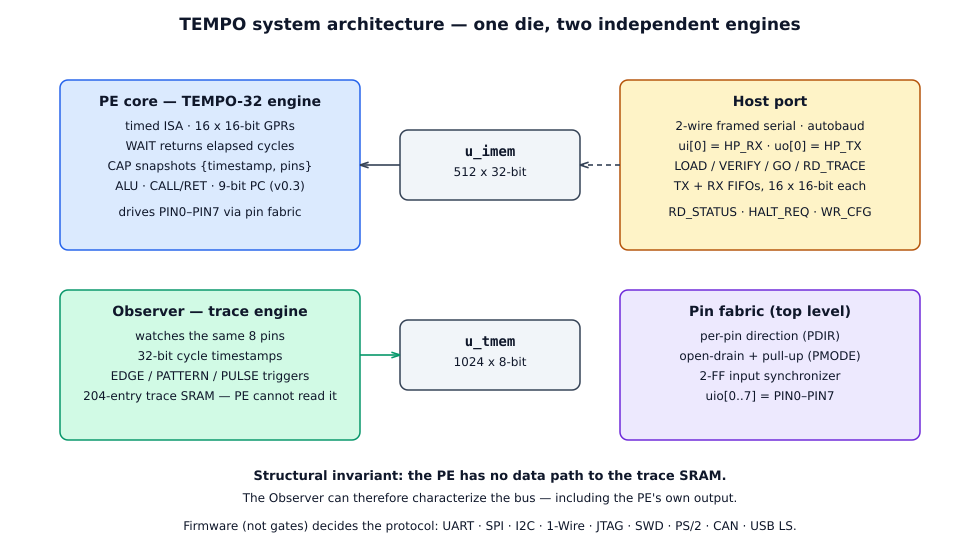
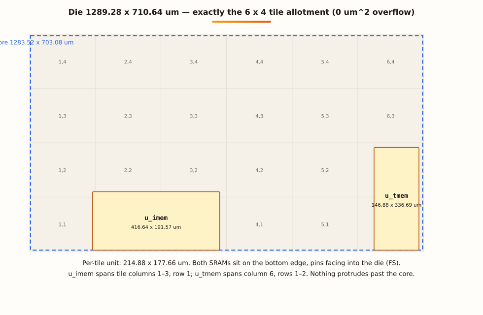
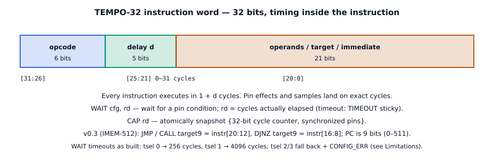
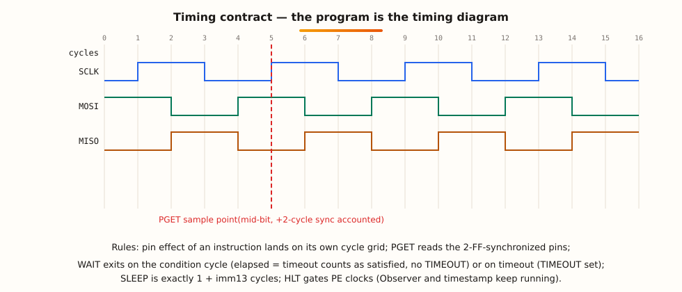
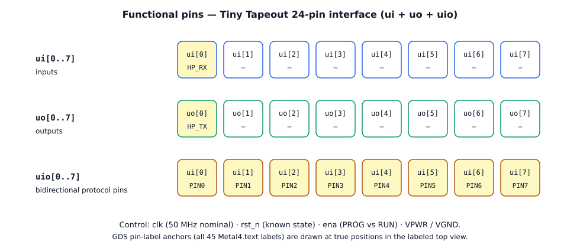
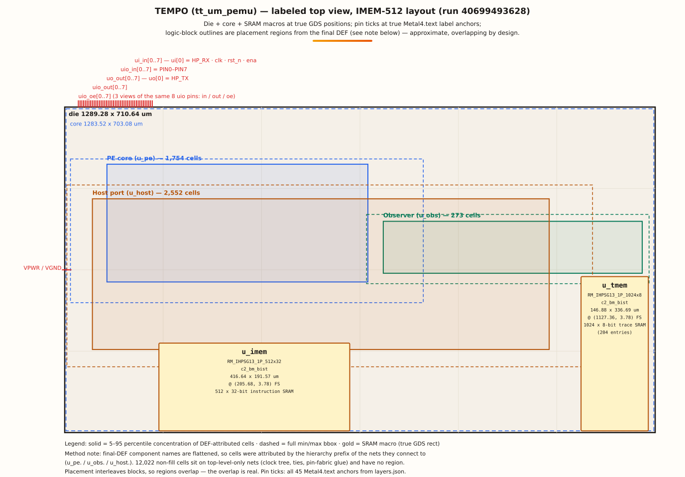
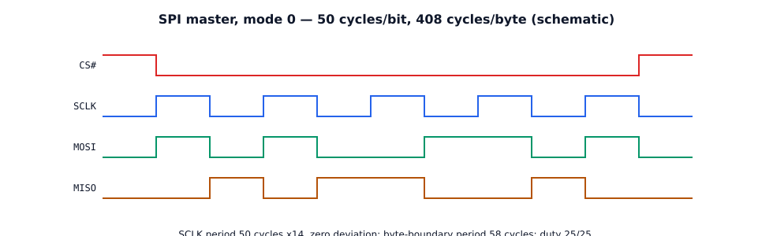
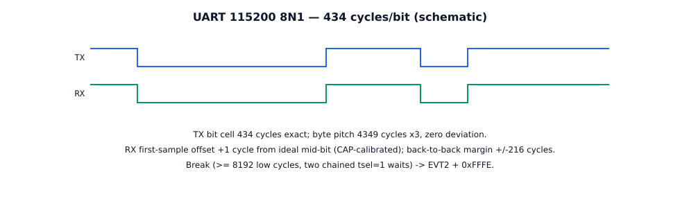
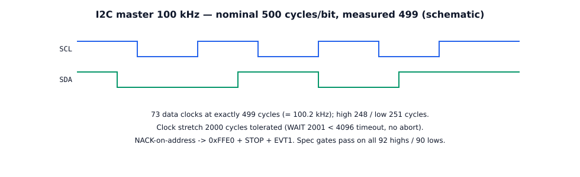
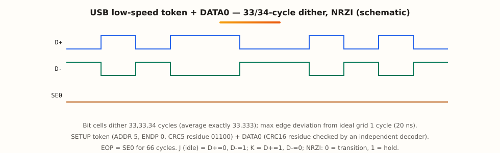

   

# TEMPO — Timing-Exact Multi-Protocol Observer

**A programmable protocol-emulator ASIC with an independent on-chip logic
analyser, for the Jane Street Protocol Emulator ASIC Competition**
(Tiny Tapeout, IHP 130 nm SG13G2 / CMOS5L, 6×4 tiles, submission deadline
18 January 2027).

TEMPO does not hard-wire a protocol. It executes firmware in a 32-bit
*timed* instruction set (TEMPO-32 ISA v0.2, extended by the v0.3 note) in
which timing is part of the program: every instruction carries a delay
field, pin effects and sampling land on exact cycles, `WAIT` returns the
cycles actually elapsed, and `CAP` atomically snapshots {timestamp,
pins}. Change the program, change the protocol — no re-spin.

Next to the engine sits the **Observer**, an independent hardware trace
block. It watches the same 8 protocol pins, timestamps events with a
32-bit cycle counter, and records them into its own trace SRAM under
firmware-set triggers. The engine has **no data path to the trace memory**
(a structural invariant, checked in the testbench), so the Observer can
be trusted to characterise the bus — including the engine's own output,
and a peer's.

> One-line version: *the debugger's chip* — a protocol generator and a
> protocol characteriser on the same die, with a formally specified timing
> contract.

📖 **Companion website (this repo, GitHub Pages-ready):**
[docs/](docs/) — architecture, full spec, protocol matrix, waveforms,
example code, FPGA test evidence, and an interactive GDS explorer with
a 3D exploded-stack view of the real 512-word layout.

## What TEMPO is

A competition entry is usually judged on what it can *do*. TEMPO's bet
is different: the chip is a **measurement instrument first, a protocol
implementation second**. The two instructions that make that claim real
are:

- **`WAIT cfg, rd`** — wait for a configured pin condition (edge/level
  with mask), with a programmable timeout; on exit `rd` holds the
  **elapsed cycles**. Autobaud, period and pulse-width measurement are
  firmware idioms, not features.
- **`CAP rd`** — atomically capture {32-bit cycle counter, synchronised
  pins} for timestamped sampling under program control.

Everything else — UART, SPI, I²C, 1-Wire, JTAG, SWD, PS/2, CAN, USB
low-speed — is firmware written against those two primitives plus
cycle-counted `SLEEP` timing. The same die, reloaded with a different
image, speaks a different protocol.

## Architecture



- **PE core (`u_pe`)** — TEMPO-32 engine: 16 × 16-bit GPRs, 20 special
  registers (MRS/MSR), ALU + flags, CALL/RET stack, TX/RX FIFOs
  (16 × 16-bit each), 9-bit PC under the v0.3 note.
- **Observer (`u_obs`)** — independent trace engine: EDGE / PATTERN /
  PULSE trigger modes, prescaler, watermark, 204-entry trace SRAM
  (`u_tmem`). Configured by firmware via MSR or by the host via WR_CFG;
  read only by the host via RD_TRACE. The PE cannot read trace memory.
- **Host port (`u_host`)** — 2-wire framed serial slave (autobaud,
  ACK/NACK) on `ui[0]` (HP_RX) / `uo[0]` (HP_TX): program loading,
  verification, run control, FIFO transfer, status, and trace readout.
- **Pin fabric (top level)** — per-pin direction (`PDIR`), open-drain
  and pull-up modes (`PMODE`), pin masking (`PMASK`), and a 2-FF input
  synchronizer feeding both the PE and the Observer.
- **SRAMs** — `u_imem`: 512 × 32-bit instruction memory;
  `u_tmem`: 1024 × 8-bit trace memory (204 entries × {timestamp[31:0],
  pins[7:0]}).



## The ISA in 60 seconds



Word format: `[31:26] opcode · [25:21] delay (0–31 cycles) ·
[20:0] operands`. 24 opcodes: `PSET PSETR PGET PMASK PDIR PMODE`
(pins), `SLEEP WAIT CAP` (timing/measurement), `MOV LDI` (data),
`PUSH PULL` (host FIFOs), `MRS MSR` (special registers incl. Observer
config), `ADD/SUB AND/OR/XOR SHL/SHR CMP` (ALU + flags),
`JMP DJNZ CALL/RET`, `HLT`, `EVT`.



Timing contract, in one paragraph: every instruction executes in
**1 + d cycles**; a pin effect lands on its own instruction's cycle
grid; `PGET` reads the 2-FF-synchronised pins (2-cycle architectural
latency, accounted for in every firmware image); `SLEEP` is exactly
**1 + imm13** cycles; a `WAIT` that finds its condition true exactly at
the deadline counts as satisfied (elapsed = timeout, no TIMEOUT sticky);
`HLT` gates PE clocks while the Observer and timestamp keep running.

**ISA versions.** v0.2 is the frozen encoding document
([docs/ISA_v0.2.md](docs/ISA_v0.2.md), machine-readable
[docs/isa_v0.2.yaml](docs/isa_v0.2.yaml)). The v0.3 note
([docs/isa_v0.3_note.md](docs/isa_v0.3_note.md)) activates the one bit
v0.2 explicitly reserved for this purpose: `target9[8]` in JMP/CALL/DJNZ
is now a live address bit, the PC is 9 bits, and IMEM is 512 words deep.
No opcode, format, or delay rule changed. The larger memory does **not**
lift the CAN DLC ≤ 2 cap (a register limit, not a word-count limit —
see Limitations).

Full specification: [docs/ISA_v0.2.md](docs/ISA_v0.2.md) ·
architecture: [docs/ARCHITECTURE.md](docs/ARCHITECTURE.md) ·
firmware notes: [docs/FIRMWARE.md](docs/FIRMWARE.md) ·
characterized limits: [docs/CHARACTERIZED_LIMITS.md](docs/CHARACTERIZED_LIMITS.md) ·
open-items audit: [docs/OPEN_ITEMS_AUDIT.md](docs/OPEN_ITEMS_AUDIT.md).

## Specification (IMEM-512, the submittable design)

| | |
|---|---|
| Die | **1289.28 × 710.64 µm** (916,214 µm²) — exactly 6×4 tiles, 0 µm² overflow; per-tile unit 214.88 × 177.66 µm |
| Core | 1283.52 × 703.08 µm (902,417 µm²) |
| Utilisation | **41.4 %** instance (31.6 % stdcell); 16,635 placed stdcells + 2 SRAM macros |
| SRAMs | `u_imem` 512×32, 416.64 × 191.57 µm @ (205.68, 3.78), FS · `u_tmem` 1024×8, 146.88 × 336.69 µm @ (1127.36, 3.78), FS |
| Power (typical) | **6.56 mW** (internal 5.50 + switching 1.02 + leakage 0.034) |
| Clock | 50 MHz nominal (20 ns cycle = timestamp resolution); **≤ 43.8 MHz for guaranteed setup across all corners** (see timing note) |
| Timing | Typical setup slack **+5.713 ns**; fast **+8.578 ns**; slow-corner (1.08 V, 125 °C) setup WNS **−2.824 ns**, TNS −157.48 ns, **112 violators** — all on the IMEM fetch path (`u_imem/A_DOUT[17]`, plus 2 reg-out from `A_DOUT[18]`); hold clean at all corners |
| Pins | **24** (ui 8 + uo 8 + uio 8), no analog pins; plus clk, rst_n, ena, VPWR, VGND |
| Program memory | 512 × 32-bit (v0.3); host loader accepts the full 16-bit base address, span ≤ 512 words, wire format unchanged (frames ≤ 63 words) |
| Trace memory | 1024 × 8-bit = 204 entries × {timestamp[31:0], pins[7:0]}; pointer saturates at 204, never wraps |
| Registers | 16 × 16-bit GPRs; 20 special registers (MRS/MSR) |
| FIFOs | TX and RX, 16 × 16-bit each, via PUSH/PULL |
| Host port | 2-wire framed serial (autobaud, ACK/NACK); LOAD_IMEM / VERIFY_IMEM / WR_CFG / RD_CFG / WR_RXFIFO / RD_TXFIFO / RD_TRACE / RD_STATUS / GO / HALT_REQ |
| Sign-off | GDS ✅ · precheck 9/9 ✅ · LVS "Circuits match uniquely" ✅ · KLayout DRC 0 errors ✅ · antenna 0 ✅ · worst IR drop 0.128 mV ✅ |
| Licence | Apache-2.0 |

### The honest timing note (read this before clocking the chip)

The slow-corner setup violation is the one genuine silicon-risk item,
and it is characterised, not hidden. At the slow corner the IMEM
fetch-path net cannot meet a 20 ns cycle: worst slack −2.824 ns, which
implies a slow-corner fmax of ≈ 43.8 MHz. **Guidance: run at ≤ 43.8 MHz
if setup must be guaranteed at the slow corner; 50 MHz is met with
margin at typical and fast corners only.** The competition sets no clock
target, and GDS, LVS, DRC, antenna, and IR-drop all pass. A timing-closure
redesign (fetch-net fanout buffering/replication or fetch pipelining)
is out of scope for this submission and would need a new hardening round.



| Pin | Name | Direction | Function |
|---|---|---|---|
| `ui[0]` | HP_RX | in | Host port receive (2-wire framed serial, autobaud) |
| `ui[1..7]` | — | in | Unused (tied off internally) |
| `uo[0]` | HP_TX | out | Host port transmit |
| `uo[1..7]` | — | out | Tied to 0 |
| `uio[0..7]` | PIN0–PIN7 | bidir | Protocol pins: driven/sampled by the PE under firmware control (direction per-pin via `PDIR`, open-drain modes via `PMODE`); also watched by the Observer |

Example firmware pin map (SPI image): SCLK = PIN2, MOSI = PIN3, CS# =
PIN5, MISO = PIN0. (USB image: D+ = PIN0, D− = PIN1.)

## Labeled layout — the real 512-word die



*Die, core, and SRAM macros at true GDS positions (IMEM-512 run
40699493628); pin ticks at true Metal4.text label anchors. Logic-block
outlines are placement regions derived from the final DEF — see the
method note in the image. The standard-cell sea is interleaved, so the
regions overlap; that overlap is real, not a drawing error. An
interactive version of this view (all 16 GDS layers, per-layer toggles,
µm probe, 3D exploded stack) lives on the [website](docs/).*

## What it can do — protocol verdicts

Every verdict below means the same thing: firmware assembled with the
project's assembler, run against the cycle-exact golden model with a
**protocol-specific wire decoder** (bytes, CRCs, parity, state sequences
— not a generic harness pass), and replayed cycle-exact against the RTL
where stated. "Proven" never means "tested on the ASIC" — the ASIC is
not fabricated yet; hardware evidence is from the Zybo FPGA port
(see "How it is tested").

### Base firmware (the four original images)

| Protocol | Image | Golden evidence | Verdict |
|---|---|---|---|
| UART 115200 8N1 | 119 words | 46,225 cycles; bit cell 434 exact; byte pitch 4349 ×3, zero deviation; RX sample +1 from mid-bit | Proven (sim + co-sim + Zybo) |
| SPI master mode 0, 1 MHz | 63 words | SCLK 50 ×14 zero deviation; 408 cycles/byte; loopback 0xA5→0x5A, 0x3C→0xC3 | Proven (sim + co-sim + Zybo) |
| I²C master 100 kHz | 199 words | 73 clocks at exactly 499 cycles; stretch 2000 cycles tolerated; NACK → 0xFFE0 + STOP + EVT1 | Proven (sim + co-sim + Zybo) |
| 1-Wire master | 130 words | Reset 480.02 µs, presence, slots to the cycle; scratchpad reads 25.0625 °C | Proven (sim + co-sim + Zybo) |

Word counts in this table are the golden-model image sizes. As loaded
on Zybo, VERIFY counts are SPI 71, UART 125, I²C 209, 1-Wire 132 words
(build512 summary).

### Stretch protocols (2026-10-27 campaign, sim + RTL co-sim)

| Protocol | Evidence | Verdict |
|---|---|---|
| JTAG | 169 words; wire-walked TAP, IDCODE **0x1BA00477** decoded from the wire, BYPASS 0xA5→0x4A | ✅ Proven |
| SWD | 111 words; IDCODE **0x2BA01477**, correct parity, zero contention | ✅ Proven |
| PS/2 | 216 words; both directions; corrupted-parity frame correctly flagged; open-drain invariant held | ✅ Proven |
| CAN 2.0A @ 1 Mb/s | 255 words; TX + ACK sampling + arbitration loss; wire CRC 0x33ea recomputed | ✅ Proven, **DLC ≤ 2** (see Limitations) |
| USB low-speed TX | 243 words; SETUP + DATA0, CRC5/CRC16 residues exact per an independent decoder, EOP SE0 66 cycles | ✅ Proven |
| USB low-speed RX | 63-word standalone loop decodes 7/7 packet types (golden model only) | ⚠️ Partial — loop proven, not integrated (see below) |
| USB merged TX+RX | **299-word** single image on the 512 build; 301-word variant proves chunk-base load/verify on Zybo | ✅ Proven (sim + co-sim + Zybo) |
| 10BASE-T Ethernet | Manchester half-bit 2.5 cycles on the 20 ns grid (±10 ns jitter vs ±5.5 ns 802.3 limit); exact Manchester needs a 100 MHz grid vs the ~43.8 MHz slow-corner ceiling; needs an analog PHY, not digital GPIO | ❌ **Not feasible on-chip — not claimed** (external-PHY-over-MII would work as a system, but that is not an ISA achievement) |

**USB, stated carefully.** Merged TX+RX in one 299-word image is proven.
A complete USB *device stack* (enumeration and beyond) is firmware work
beyond the shipped image, not a chip limitation. The RX loop alone is
proven; the TX+RX integration gap on the 256-word baseline was a word
budget (291 > 256), which the 512-word memory closes for the merged
image.

## Waveforms (schematic — cycle counts are measured, shapes are illustrative)









## Example code — real firmware, not pseudocode

### SPI master: init + command loop (excerpt from `firmware/spi/spi.asm`)

```asm
; TEMPO-32 SPI master firmware -- mode 0 (CPOL=0, CPHA=0), 1 MHz
; 50 MHz core -> 20 ns/cycle; 1 Mbit/s -> exactly 50 cycles/bit.
; HOST COMMAND WORDS (16-bit, via RX FIFO; responses via TX FIFO):
;   0x0001  TRANSFER : PULL N (byte count, 0..15), then PULL N data words
;                      (low 8 bits used). CS# low for the whole N-byte
;                      transaction, full-duplex MSB-first bit-bang.
;                      PUSH one received-byte word per byte, then PUSH
;                      0x0000 status, `evt 0`, loop.
;   0x0003  SET MODE : mode 3 NOT implemented; consumes the arg word,
;                      PUSHes 0xFFFF (unsupported), `evt 0`, loop.
;   0x00FF  HALT     : HLT (host GO wakes).
;   other            : PUSH 0xFFFF (unknown), `evt 0`, loop.

; ---- init: R_ONE idiom, pin config, constants -------------------
; NOTE: pdir 0x01 (not 0xFF) for R_ONE -- idle levels are committed
; BEFORE pdir enables the drivers, or CS# glitches low for ~2 cycles.
        pdir 0x01
        pmask 0xFF
        pset 0x01, d=4
        pget r15                 ; r15 = 1 (preserve forever)
        pmask 0x2C               ; pin ops touch only pins 2,3,5
        pset 0x20                ; idle levels first: CS#=1, SCLK=0, MOSI=0
        pdir 0x2E                ; THEN drive SCLK(2), MOSI(3), CS#(5)
        xor r0, r0, r0           ; r0 = 0
        ldi r9, 4                ; SCLK bit mask, also shr-by-4 amount
        ldi r14, 0x0100
        sub r14, r14, r15        ; r14 = 0xFF (byte mask, 0x00FF compare)
        ldi r12, 8               ; shl-by-8 amount

; ---- host command loop -------------------------------------------
; RACE FIX 2026-09-27: every PULL is preceded by an RXNE wait.
cmd_loop:
        jmp cmd_have, rxne       ; wait for host command word
        jmp cmd_loop
cmd_have:
        pull r6                  ; cmd word
        cmp r6, r15              ; 0x0001 = transfer?
        jmp do_xfer, z
        cmp r6, r13              ; 0x0003 = set mode?
        jmp do_mode, z
        cmp r6, r14              ; 0x00FF = halt?
        jmp do_hlt, z
        jmp do_unk               ; unknown cmd

; ---- 0x0001 transfer (byte loop: 50 cycles/bit; rising edge = `psetr r2`)
do_xfer:
        jmp xfer_n_have, rxne
        jmp do_xfer
xfer_n_have:
        pull r8                  ; N bytes
        pset 0x00                ; CS# low (SCLK=0, MOSI=0)
        cmp r8, r0               ; N == 0?
        jmp xfer_done, z
        ; ... per-byte: pull data word, 8x bit_loop, push received byte ...
        ; bit_loop: shl tx bit -> C; psetr MOSI+SCLK; pget sample mid-high;
        ;           17 fixed insns + SLEEP16 + SLEEP3 + SLEEP14 = 50 cycles.
```

The full image is 63 words in the golden model; the Zybo harness loads
71 words (build512 VERIFY 71/71).
Measured: SCLK period 50 cycles ×14 with zero deviation, one 58-cycle
period at each byte boundary, 408 cycles/byte — the golden checker
originally expected 57/407, which was a stale checker expectation, not a
chip deviation (see Limitations and the audit).

### USB low-speed TX: what the host sends (from `firmware/usb/usb.asm`)

```asm
; USB 1.1 LOW-SPEED device-side TRANSMIT firmware
; LS bit = 666.67 ns = 33.333 cycles (fractional).
; DITHER: cells are 33,33,34 repeating -> average exactly 33.333
; cycles/bit, max edge deviation from ideal grid <= 1 cycle (20 ns).
; PIN MAP: pin0 = D+, pin1 = D-, push-pull (pmask/pdir = 0x03).
;   J (LS idle) = D+=0, D-=1 -> pins byte 0x02. K = 0x01. SE0 = 0x00.
;   NRZI: data 0 = transition, data 1 = no transition. Bit stuffing:
;   a 0 is inserted after six consecutive 1s, including after the CRC.
;
; HOST COMMAND WORDS (16-bit words via RX FIFO):
;   0x0001 TX : PULL N (payload byte count, 1..8), then PULL N payload
;               byte-words. Transmits, back to back (~10 bit-time J gap):
;               (1) SETUP token: SYNC, PID SETUP=0x2D, ADDR=0x05, ENDP=0x0,
;                   CRC5, EOP.
;               (2) DATA0: SYNC, PID DATA0=0xC3, N payload bytes, CRC16, EOP.
;               Then PUSH 0x0000 status, evt 0, loop.
;   0x0002 RX : NOT IMPLEMENTED in this image -> 0xFFFF.
;   0x00FF    : HLT.
;
; TOKEN FIELD CONSTANTS (precomputed, verified by the independent decoder):
;   SYNC(0x80) + PID(0x2D) as one 16-bit LSB-first stream = 0x2D80
;   ADDR/ENDP/CRC5 as one 16-bit LSB-first stream            = 0xD005
;   CRC16 kept in reflected form (poly 0xA001); transmit ~rc LSB-first.
;   Independent decoder (spec MSB-first LFSR) residues: CRC5 01100,
;   CRC16 1000000000001101 -- both exact.
```

## How to use the chip

1. **Reset.** Assert `rst_n` to reach a known state. `ena = 0` selects
   PROG mode; `ena = 1` selects RUN mode.
2. **Load.** Over the host port (autobaud framed serial, ACK/NACK):
   `LOAD_IMEM` writes {addr16, data…} frames (≤ 63 words per frame) into
   IMEM; `VERIFY_IMEM` reads the image back byte-identical. LOAD and
   VERIFY are rejected while the PE is running — halt first, or load
   before the first GO.
3. **Configure (optional).** `WR_CFG` sets pin mux, Observer trigger
   mode/masks, prescaler, and watermark. The Observer can also be
   configured by firmware via MSR; either way, the PE never touches
   trace memory.
4. **Run.** `GO` releases PE reset with PC ← 0. The firmware runs its
   command loop: the host pushes command/data words with `WR_RXFIFO`
   and pops responses/events with `RD_TXFIFO`. Firmware images are
   command-driven (SPI 0x0001 transfer, USB 0x0001 TX, …) and signal
   completion with `evt 0`.
5. **Observe.** `RD_TRACE` reads trace entries {timestamp, pins} plus
   `OBS_PTR`. `RD_STATUS` returns {PE_RUNNING, PE_HALTED, TIMEOUT,
   TX_EMPTY, RX_FULL, TRACE_WM, TRACE_FULL, CONFIG_ERR}. A host
   `HALT_REQ` requests a clean stop; re-`GO` restarts from PC 0.
6. **Reload.** Program reload on reselect is supported: halt, reload
   via LOAD_IMEM, re-verify, GO. No power cycle is needed.
7. **Clock.** Nominal 50 MHz; for guaranteed setup across all corners,
   run at ≤ 43.8 MHz (see the timing note above). Timestamp resolution
   is one clock cycle at whatever clock you run.

## How it is tested on FPGA (Zybo)

The ASIC is not fabricated yet, so "hardware-proven" here means proven
on the Zybo FPGA port of the same RTL + firmware images, through a
three-stage equivalence methodology:

1. **Golden model** — the cycle-exact ISA simulator (`sim.py`) is the
   reference. Every protocol image passes its protocol-specific checker
   there first.
2. **Cycle-exact RTL co-sim** — RTL traces are replayed against golden
   traces and must match cycle-for-cycle (SPI 855/855, UART 8,747
   cycles, USB merged 6,297 cycles, and 11/11 co-sim cases overall).
3. **Zybo hardware** — the image is loaded over the host port into the
   FPGA build, run against a peer harness, and checked by milestones +
   a run signature. The harness loader implements LOAD / VERIFY / GO /
   TRANSFER / RD_TXFIFO.

### test512 matrix (IMEM-512 build, 50 MHz unless noted)

| Test | Milestones | Signature | Result |
|---|---|---|---|
| SPI @ 50 MHz | 0x7fff (15/15) | 0xa6b864d9 | ✅ PASS |
| UART @ 50 MHz | 0x03ff | 0x30708354 | ✅ PASS |
| I²C @ 50 MHz | 0x03ff | 0x6e253f7c | ✅ PASS |
| 1-Wire @ 50 MHz | 0x03ff | 0xbd40f1c9 | ✅ PASS |
| USB merged TX+RX (299w) @ 50 MHz | 0x03ff | 0x63063af2 | ✅ PASS |
| USB merged TX+RX (301w, ahi=1 chunk-base load) @ 50 MHz | 0x03ff | 0x1611ee4b | ✅ PASS |
| Ubproof @ 50 MHz | 0x03ff | 0x3896fcc5 | ✅ PASS |
| SPI @ 125 MHz (×2 runs) | 0x7fff | 0xa6b864d9 (identical to 50 MHz) | ✅ PASS — but see the 125 MHz caveat in Limitations |
| SPI fault-injection (fault 1) | caught at post-HALT RD_STATUS, fail_code 0xEE | 0xcb6b9ef1 | ✅ VACUITY-OK (no false pass) |

The 0xEE code deserves one sentence: an injected fault must produce a
*failing* run, never a false pass. The harness's post-HALT status check
catches it via the diagnostic drain (T_DG) — that is the vacuity guard
working, not a chip failure.

Overall verification depth (all stages): 643 benches, formal 32/32 on
the ISA-contract subset, 11/11 cycle-exact co-sims, 4 base protocols on
Zybo hardware plus stretch protocols in sim/co-sim.

## Honest limitations — what this chip does not do

These are bounded, characterised behaviours, not surprises. Full
evidence: [docs/CHARACTERIZED_LIMITS.md](docs/CHARACTERIZED_LIMITS.md)
and [docs/OPEN_ITEMS_AUDIT.md](docs/OPEN_ITEMS_AUDIT.md) (2026-10-29
audit). After that audit, **no unhandled chip-functionality bug
remains**; the functionality-affecting list is exactly: the slow-corner
timing guidance above, the T17 decision item below, and these limits.

- **CAN DLC ≤ 2.** CAN 2.0A TX + ACK + arbitration at 1 Mb/s is proven,
  but frames carry at most 2 data bytes. The design has no data RAM and
  all 16 GPRs are allocated mid-frame, so there is nowhere to hold a
  longer destuffed stream. A DLC > 2 request has its argument words
  consumed and discarded and returns 0xFFFF. IMEM-512 does not lift this
  cap — it is a register limit, not a word-count limit. A redesign
  (data RAM or an extra stream register) is out of scope.
- **UART TX host starvation blocks.** If the host declares N data bytes
  but stops supplying them, the firmware waits in its receive-ready
  loop for the next word. It does not time out and does not push 0xFFFD
  on this path (the 0xFFFD abort exists as a safety net for pulls that
  bypass the wait, which normal operation never does). Recovery is
  supplying the missing word, or a host reset/reload. This is a
  firmware-demo limitation, not a PE bug: the PE executes the wait loop
  exactly as written.
- **WAIT long timeouts are not implemented (T17, decision item).**
  `tsel` 0 → 256 cycles, `tsel` 1 → 4096 cycles. `tsel` 2/3 (the
  65536/1048576-cycle presets in the ISA table) are **not implemented**:
  they fall back to 256/4096 respectively **and set CONFIG_ERR**. The
  largest elapsed value ever written is 4096, so no overflow can occur
  as built. Firmware must not use tsel 2/3 expecting a long timeout.
  The standing recommendation (rule tsel 2/3 out of the submitted ISA,
  document CONFIG_ERR + fallback, firmware chains tsel=1 waits — as the
  UART break rule already does) is a decision for the ISA lead, not
  shipped behaviour; saturating elapsed at 0xFFFF is **not**
  implemented and is not claimed. The alternative (implement the
  presets with saturation) would need an ISA version bump and a full
  re-verification gate.
- **SPI at 125 MHz: observed, not guaranteed.** The proven SPI
  operating point is 50 MHz (15-milestone proof). The 256-word baseline
  failed deterministically at 125 MHz (fail code 0x13, 13/15 runs); the
  512-word build passed twice at 125 MHz with the identical signature,
  but the baseline failure was never root-caused and no fix was
  attempted or is claimed. 125 MHz is reported as observed, not as a
  guaranteed operating point.
- **Observer PULSE mode watches pin 0 only.** The top level ties the
  Observer's pin-select input to 0 (the PE port list does not expose
  it), so PULSE triggering watches pin 0 regardless of the PIN_SEL
  special-register value. EDGE and PATTERN modes are unaffected (they
  use masks). Trace entries saturate at 204 and never wrap; TRACE_WM is
  sticky and cleared only by OBS_CLR.
- **Observer hardware capture is the remaining score item, not a chip
  bug.** The Observer works in sim and co-sim (bench `tb_observer`, 35
  checks), but **no hardware trace-SRAM capture has ever been
  demonstrated**: the programmed Zybo harness has no RD_TRACE path
  (its loader implements LOAD / VERIFY / GO / TRANSFER / RD_TXFIFO
  only). The silicon path exists (host command 0x07 RD_TRACE, firmware
  Observer configuration via MSR), but using it on the board needs a
  scoped harness build (Observer-configuring firmware + loader-FSM
  extension + rebuild + validation). It is stated plainly here so no
  reader mistakes a sim trace for a board capture.
- **USB device stack / 10BASE-T.** Merged USB TX+RX is proven; a
  complete device stack (enumeration and beyond) is firmware work
  beyond the shipped image. 10BASE-T is not feasible on-chip (three
  independent grounds in the verdict table) and is not claimed.
- **Other defined behaviours** (documented, tested, even where the ISA
  TBD table still lists them open): illegal opcodes 24–63 execute as
  NOP and set CONFIG_ERR; CALL on a full return stack drops the call
  and sets CONFIG_ERR; RET on an empty stack is a NOP and sets
  CONFIG_ERR; unallocated special registers read as zero; SPI mode 3
  returns 0xFFFF (unsupported); SPI N=0 is a 3-cycle CS# pulse with no
  SCLK.

### What is still open (non-functional)

- **Formal competition entry** — the Jane Street submission form is not
  yet published; deadline 18 January 2027. The entry itself is the
  submitter's step, and a perfect chip with no entry scores zero.
- **GitHub Pages / viewer job** — CI is green on gds, precheck,
  gl_test, test, and docs; the viewer job fails only because Pages is
  not enabled on this private repo. That toggle is the submitter's
  settings call and is deliberately not changed here.
- **Phase 7 verification depth** (formal timing contract,
  constrained-random, agentic campaign) — queued, not started; it adds
  depth to already-strong evidence, not existence.
- **Display-name collision** — another public project uses "Tempo";
  the repo name `tt_um_pemu` is fixed by Tiny Tapeout convention, so
  only the display name is at stake. Undecided.

## Repository map

| Path | What it is |
|---|---|
| `src/` | RTL: `tt_um_pemu.v` (top), `tt_um_pemu_pe.v`, `tt_um_pemu_observer.v`, `tt_um_pemu_host.v`; `config.json` (Tiny Tapeout flow config) |
| `docs/ISA_v0.2.md`, `docs/isa_v0.2.yaml` | Frozen ISA encoding (doc + machine-readable source of truth) |
| `docs/isa_v0.3_note.md` | v0.3 note: 9-bit target activation, 512-word IMEM |
| `docs/ARCHITECTURE.md` | Architecture + timing contract + host protocol |
| `docs/FIRMWARE.md` | Firmware images + measured-vs-theory tables |
| `docs/CHARACTERIZED_LIMITS.md` | Plain-language bounds (single source of truth for limits) |
| `docs/OPEN_ITEMS_AUDIT.md` | 2026-10-29 functionality open-items audit + dispositions |
| `docs/open-items/test_spi_checker_fix.patch` | The test_spi checker fix (57→58, 407→408) as a patch record |
| `docs/` (site) | Static website: `index.html` + `assets/` (diagrams, layers.json, explorer + 3D view) |
| `docs/assets/generate_diagrams.py` | Generator for every SVG in this README and the site |
| `test/` | Verilator benches (643 checks), formal properties, co-sim harness |
| `fpga/` | Zybo port: harness RTL, loader, `test512` logs + bitstreams |

## Status

- **Design:** IMEM-512, flow-complete and proven (GDS green, precheck
  9/9, gl_test green, docs green). The 256-word baseline is tagged
  `v1.0-proven-256` as the rollback point.
- **Submission:** formal entry form not yet published by Jane Street
  (deadline 18 January 2027); viewer/Pages toggle is the submitter's
  call; nothing in this branch merges to `main` or changes repo
  visibility on its own.
